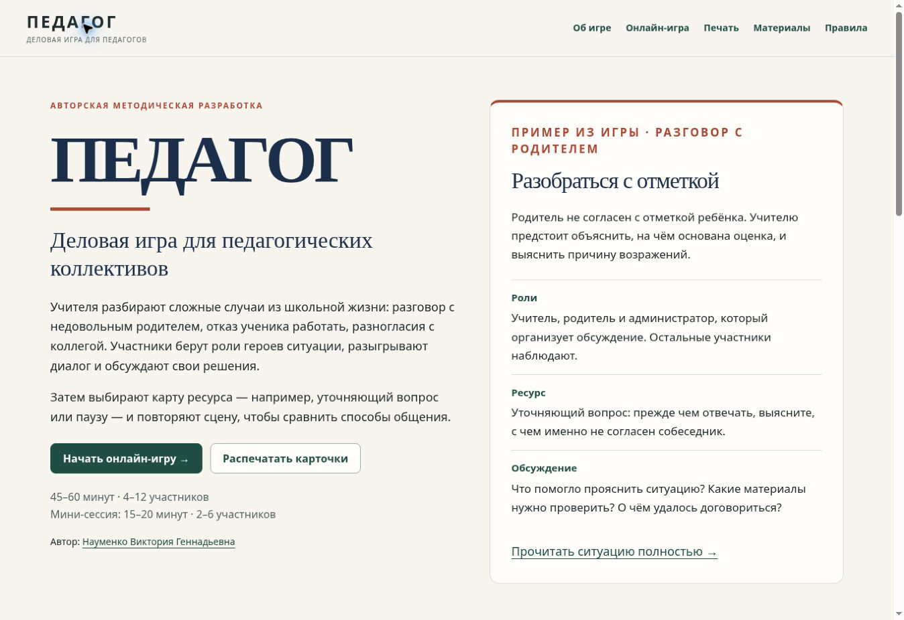
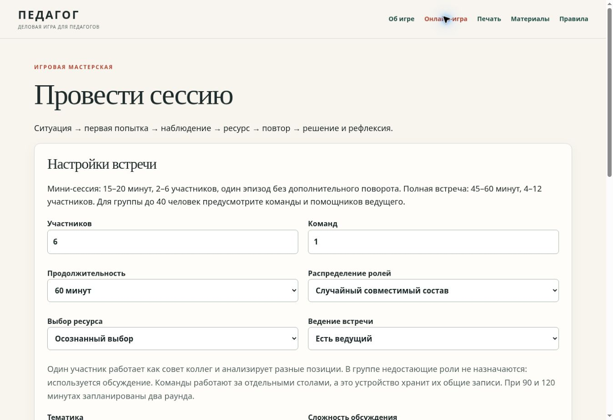
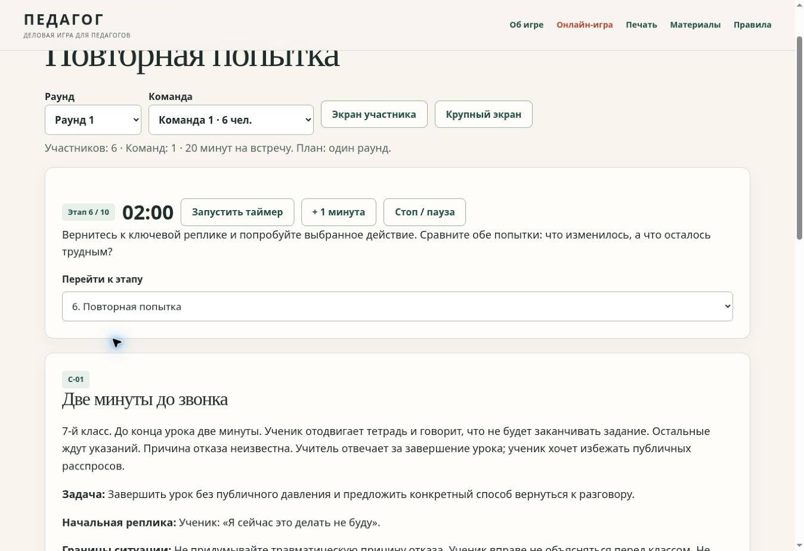
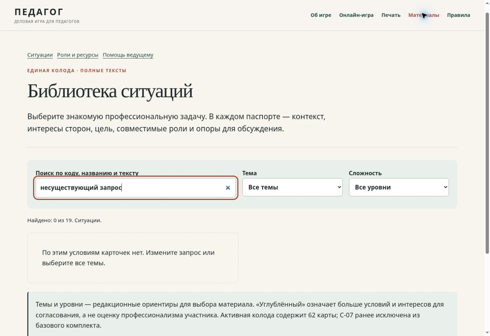
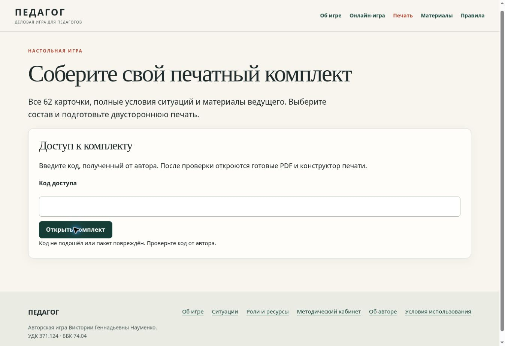
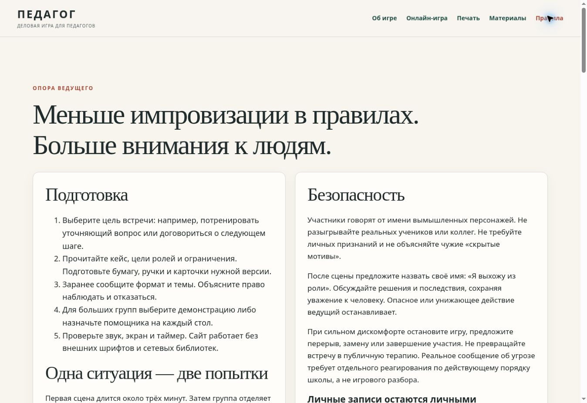
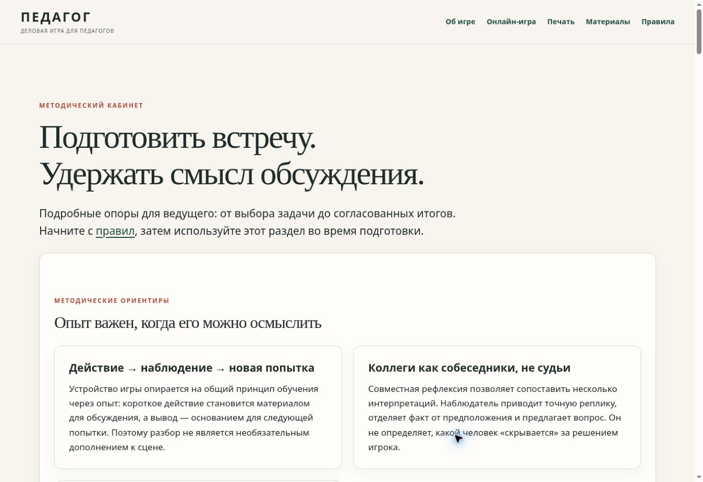
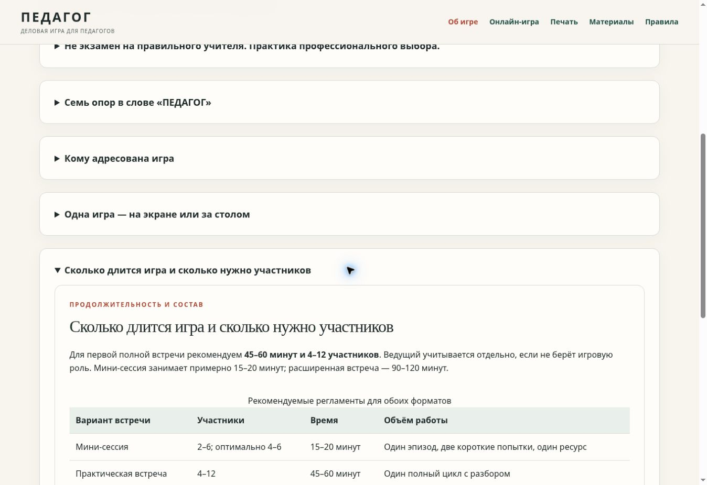
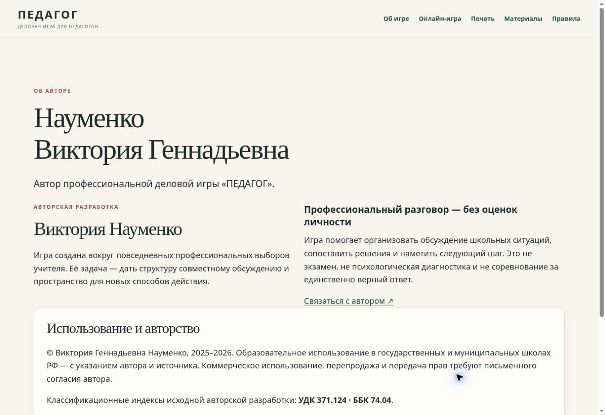
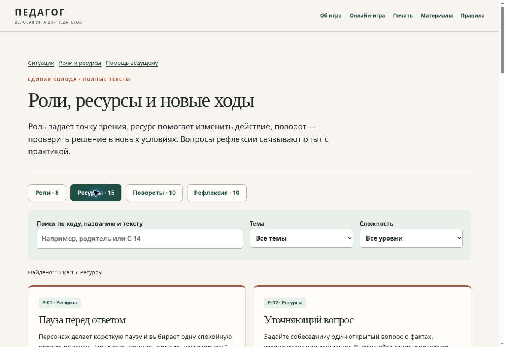

# Аудит «ПЕДАГОГ» — 28 октября 2026

Проверен существующий сайт https://0011nvg.github.io/pedagog/ и код репозитория `0011nvg/pedagog`. Исходная версия: `3e02e3cdf66e4b9ff8ef93fbf06a8696301c66eb`. Исправления: ветка `audit/site-quality-2026-10-28`, [PR №2](https://github.com/0011nvg/pedagog/pull/2). Это аудит интерфейса, логики и исходников, а не подтверждение педагогической эффективности.

## Итог

Основная структура, авторская подача и тексты 62 карт сохранены. Исходная сборка и тесты проходили, однако интерактивная проверка и чтение кода обнаружили дефекты, которые они не покрывали. Исправлены переходы игрового цикла, риск перезаписи сохранения другой вкладкой, работа фокуса, навигация каталога, сброс предпросмотра печати и ссылки со вложенной страницы 404.

## Маршрут проверки

| Шаг | Проверка | Состояние / результат |
|---|---|---|
| 1 | Главная: описание, пример, вход в игру и печать | Работает; сохранены авторская композиция и два формата |
| 2 | Настройки и запуск мини-сессии на 20 минут | Запуск работает; исправлены потеря согласия и фокуса при фильтрации |
| 3 | Переход к повторной попытке | Подтверждён обход выбора ресурса через список этапов; исправлено в общей модели |
| 4 | Библиотека: поиск и отсутствие результатов | Поиск работает; добавлен сброс всех фильтров, исправлена обработка якорей |
| 5 | Печать: доступ и неверный код | Ошибка отображается корректно; добавлена ссылка на автора, исправлена инвалидизация предпросмотра |
| 6 | Правила | Страница и ссылки доступны; мини-сессия приведена в соответствие с игровой логикой |
| 7 | Методический кабинет | Материалы, таблицы регламентов и ссылки доступны |
| 8 | Об игре: раскрытие подробностей | Раскрытие работает, регламенты согласованы с моделью времени |
| 9 | Автор и условия использования | Информация и ссылка на контакт присутствуют; внешняя переписка не выполнялась |
| 10 | Колода: переключение ролей и ресурсов | Переключение работает; улучшены прямые ссылки и восстановление после пустого результата |
| 11 | 404, хранение, экспорт/импорт, печатная раскладка | Проверка исходников и автоматические регрессии; ограничения ниже |

## Исправленные дефекты

1. **Высокий приоритет — обход обязательного ресурса.** Список этапов напрямую вызывал переход, минуя проверку кнопки «Следующий этап». Общая модель теперь отклоняет переход к этапам после выбора ресурса, если ресурс не выбран хотя бы у одной команды. Сообщение получает фокус; выбранный этап возвращается к текущему. Завершить встречу отдельной кнопкой по-прежнему можно.
2. **Высокий приоритет — устаревшая вкладка перезаписывала сохранение.** Таймер записывал состояние каждую секунду, а закрытие вкладки снова сохраняло его. Добавлены сравнение с последним прочитанным значением и обработка события `storage`: при конфликте таймер останавливается, перезапись блокируется, предлагается скачать локальные записи и обновить страницу. Это обнаружение конфликтов, не сетевая синхронизация и не транзакционная блокировка между процессами.
3. **Средний — повороты в мини-сессии.** Инструкция исключала повороты на 15–20 минутах, интерфейс и модель их разрешали. Новые повороты в мини-сессии отключены, подсказка изменена. Исторические сохранения с такими поворотами остаются читаемыми.
4. **Средний — потеря фокуса при перерисовке игры.** Активный элемент удалялся, клавиатурный пользователь возвращался к началу документа, а заголовок мог оставаться за верхней границей экрана. Управляющие элементы теперь сохраняют фокус, переход этапа переводит его к заголовку с учётом закреплённой шапки.
5. **Средний — сброс согласия при изменении темы/сложности.** Галочка договорённостей сохраняется при обновлении формы вместе с введёнными параметрами.
6. **Средний — устаревший печатный набор.** Предпросмотр сбрасывался только по `change`, а ошибка новой сборки могла оставить старые страницы. Теперь `input` сразу отключает печать и очищает предпросмотр; новая сборка очищает предыдущий результат до проверки параметров. Сообщение объясняет необходимость сформировать набор снова.
7. **Средний — навигация с вложенного URL 404.** Ссылки в шапке и подвале были относительными и вели в несуществующие вложенные разделы. Все локальные ссылки и ресурсы страницы 404 привязаны к `/pedagog/`.
8. **Низкий — прямые ссылки и пустое состояние каталога.** Повреждённый percent-encoded якорь мог вызвать исключение; якорь скрытой фильтрами карточки не открывался; обработчик не раскрывал карточку при последующем изменении hash. Добавлены безопасное декодирование, раскрытие целевой карточки, согласование категории и кнопка сброса фильтров.
9. **Доступность навигации.** Меню закрывается по Escape с возвратом фокуса, по внешнему клику и переходу; доступное название отражает состояние. Ссылка «К содержанию» переводит клавиатурный фокус в контент.
10. **Адаптивность и документация.** Ограничены ширины контролов, добавлены переносы длинного текста и полноширинные подписи на узком экране. README и описание сессии дополнены существующим 15-минутным режимом.

## Автоматические проверки

- `npm run build` — девять страниц и 404 собраны из исходников.
- `npm test` — пути и якоря, уникальные ID, синтаксис JS, метаданные, 62 активные карточки; 12 групп проверок игрового движка; 28 сочетаний двусторонней раскладки, экранирование HTML и полнота текстов; контроллер сессии, конфликт записи/удаления, `pagehide`, ошибка квоты хранилища.
- Тест контроллера использует минимальный DOM-стенд и не заменяет визуальную проверку браузером.
- `git diff --check` — без ошибок пробелов.
- `src/deck.js` и `print-pack.js` побайтно не изменены.
- GitHub Actions проверяет также соответствие сгенерированных страниц исходникам. Результат выпуска и повторной проверки опубликованного сайта фиксируется в PR.

## Безопасность, содержание и границы проверки

Внешние скрипты и шрифты для работы приложения не нужны. Пользовательские записи экранируются при отображении, импорт ограничен размером и схемой. Код печати не сохраняется; шифрованный комплект не изменён. Публичность каталога является существующим свойством проекта; общий код не превращён в персональную лицензию.

Карты сохраняют вымышленные ситуации, добровольность участия, право остановиться и специальный режим С-17 без инсценировки. Проверено соответствие игровых связей, а не юридическая актуальность библиографии или эффективность методики в реальном коллективе.

**Не проверено полностью:** разблокировка настоящего PDF-пакета (код автора не предоставлен), скачивание расшифрованных PDF, физическая двусторонняя печать; реальные iOS/Android и работа со скринридером. В доступном облачном браузере нет документированного переключения viewport: мобильные правила проверены по CSS, но визуальная мобильная проверка не заявляется. Полное соответствие WCAG не заявляется. Результаты скриншотов относятся к десктопному браузеру 1348 × 926.

## Скриншоты исходного состояния

Сняты непосредственно с опубликованного сайта в ходе этого аудита. На шаге 3 видно, что повторная попытка уже открыта; DOM одновременно показывал «Ресурс ещё не выбран» ниже видимой области. Это функциональная ошибка, подтверждённая взаимодействием, а не вывод только по изображению.

### 1. Главная

### 2. Настройки сессии

### 3. Переход без ресурса до исправления

### 4. Пустой результат поиска

### 5. Неверный код печати

### 6. Правила

### 7. Методический кабинет

### 8. Раскрытый регламент

### 9. Автор

### 10. Категория ресурсов

